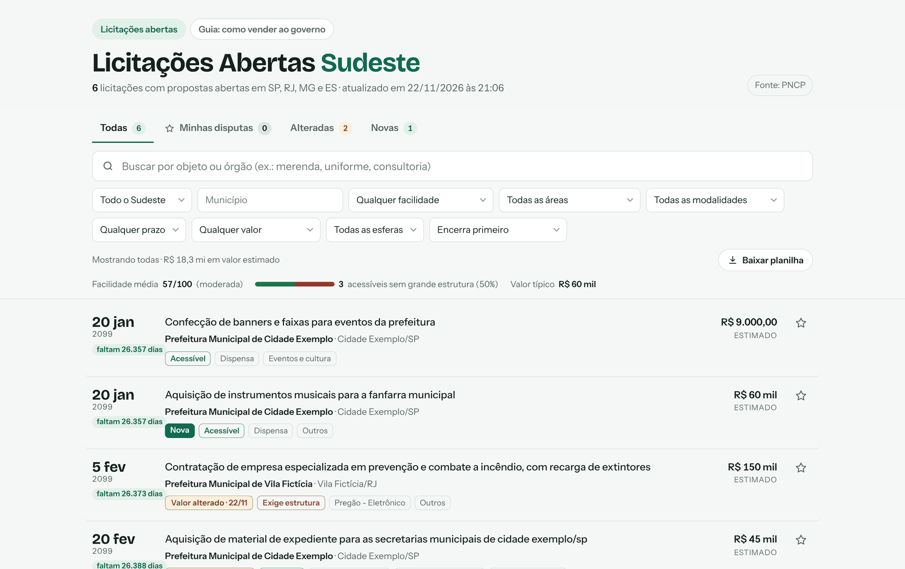
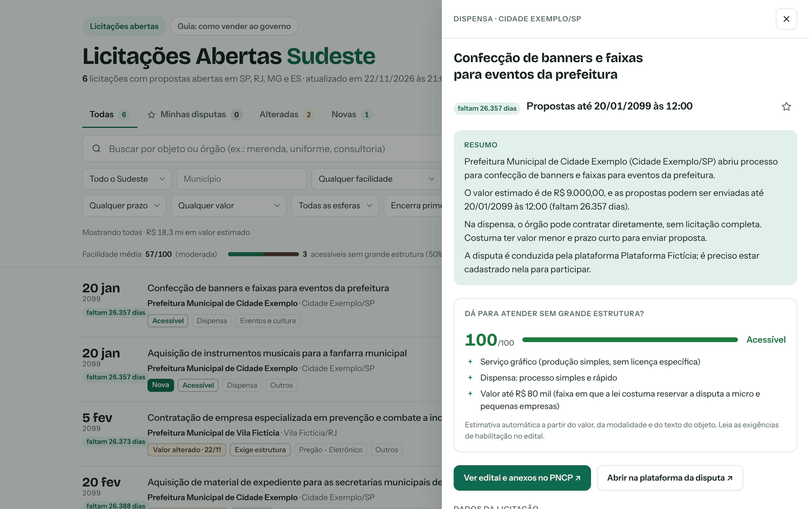
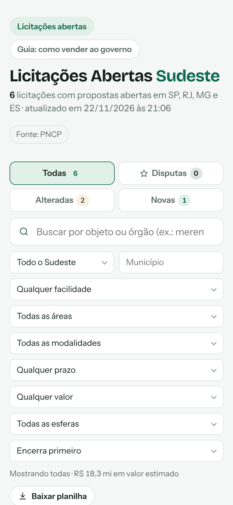

# Licitações Abertas Sudeste

Site que reúne **todas as licitações com propostas em aberto em SP, RJ, MG e ES**, atualizado automaticamente todos os dias com dados públicos do [PNCP — Portal Nacional de Contratações Públicas](https://pncp.gov.br).

🔗 **Site:** [maluake.github.io/licitacoes-abertas](https://maluake.github.io/licitacoes-abertas/)

<p>
  
</p>

## O problema

O PNCP centraliza as contratações públicas do país, mas encontrar oportunidades abertas exige muitas consultas, filtros técnicos e leitura de textos longos, muitas vezes todos em maiúsculas. Para uma pequena empresa, é difícil saber o que está aberto agora, o que mudou desde ontem e o que dá para atender sem uma grande estrutura.

## O que o site faz

- **Lista as licitações abertas do Sudeste**, com busca e filtros por estado, município, área, modalidade, prazo, valor, esfera e facilidade.
- **Abas Todas, Minhas disputas, Alteradas e Novas.** "Minhas disputas" guarda favoritas no navegador, com contagem regressiva e aviso de mudança. "Novas" e "Alteradas" mostram os últimos 7 dias.
- **Histórico de alterações** por licitação: prazo, valor, objeto, situação, link e edital, comparando cada coleta com a anterior.
- **Resumo em linguagem simples** de cada licitação, com links para o edital no PNCP e para a plataforma da disputa.
- **Nota de facilidade (0 a 100):** uma estimativa de quanto a licitação pode ser atendida sem grande estrutura, sempre com os motivos.
- **Exportação para Excel** da lista filtrada.
- **Guia** para quem está começando: tipos de licitação, regras, benefícios para pequenas empresas e glossário.

| Detalhes de uma licitação | No celular |
|---|---|
|  |  |

> As imagens usam os **dados fictícios dos testes** (`tests/fixtures/`), com órgãos inventados e prazos em 2099. Por isso aparece "faltam 26 mil dias".

## Como funciona

```
GitHub Actions (todo dia às 06:17)
   │
   ├─ scripts/coletar.mjs ──► API do PNCP  /v1/contratacoes/proposta
   │     · divide a coleta por estado × modalidade (listas curtas falham menos)
   │     · novas tentativas com espera crescente e limite de tempo
   │     · aborta se vier menos da metade, para não publicar dados incompletos
   │
   ├─ scripts/lib/regras.mjs
   │     · limpa os textos · classifica por área · calcula a nota de facilidade
   │     · compara com a coleta anterior: novas e alteradas
   │
   ├─ site/data/*.json  (lista compacta + detalhes por estado + histórico)
   │
   └─ GitHub Pages ──► site estático (HTML, CSS e JavaScript)
```

Explicação detalhada, incluindo como a nota de facilidade é calculada: [docs/COMO-FUNCIONA.md](docs/COMO-FUNCIONA.md).

## Tecnologias

| Parte | Tecnologia |
|---|---|
| Coleta e tratamento | Node.js 20 (sem dependências externas) |
| Fonte de dados | API REST pública do PNCP |
| Automação e publicação | GitHub Actions (agendamento diário) + GitHub Pages |
| Site | HTML, CSS e JavaScript puro |
| Planilha | SheetJS, carregada só no clique, com CSV de reserva |
| Testes | `node:test` com dados fictícios, rodando no GitHub Actions |

## Estrutura

```
scripts/coletar.mjs           coleta no PNCP e geração dos arquivos do site
scripts/lib/regras.mjs        regras puras: limpeza, categorias, facilidade, alterações
site/                         index.html, guia.html, app.js, style.css
tests/                        testes das regras e da coleta de ponta a ponta
tests/fixtures/               licitações fictícias no formato da API
.github/workflows/            atualizar.yml (coleta diária + publicação) · testes.yml
docs/                         documentação e imagens
```

## Rodar localmente

Requer Node.js 20 ou mais recente.

```bash
node scripts/coletar.mjs          # baixa os dados reais do PNCP (alguns minutos)
cd site && python3 -m http.server # abre em http://localhost:8000
```

Para testar sem acessar a API, use os dados fictícios:

```bash
FIXTURE=tests/fixtures/pncp-amostra.json node scripts/coletar.mjs
```

Para incluir outros estados, ajuste `UFS` em `.github/workflows/atualizar.yml` (ex.: `"SP,RJ,MG,ES,PR"`).

## Testes

```bash
npm test
```

São 14 testes com `node:test`:
- regras de limpeza de texto, categorias, nota de facilidade (inclusive os tetos), detecção de alterações e formatação;
- coleta de ponta a ponta com dados fictícios: filtros, ordenação, arquivos gerados e marcação de licitações novas e alteradas entre duas coletas.

Rodam em cada pull request, sem acessar o PNCP.

## Publicar a sua própria cópia

1. Faça um fork do repositório.
2. Em **Settings → Pages**, em *Source*, escolha **GitHub Actions**.
3. Em **Actions → Atualizar licitações**, clique em **Run workflow** para a primeira carga (leva alguns minutos).

Depois disso, ele se atualiza sozinho todo dia.

## Limitações

- A **nota de facilidade é uma heurística** por palavras-chave, não uma análise jurídica. As exigências reais estão sempre no edital.
- A categoria também é definida por palavras-chave: algumas licitações caem em "Outros".
- Se o PNCP estiver instável, a coleta pode ficar parcial. Nesse caso, o site avisa e reaproveita os dados da coleta anterior.
- Os favoritos ficam no navegador e não sincronizam entre dispositivos.

## Como este projeto foi feito

Desenvolvi este projeto **com auxílio de inteligência artificial**: usei o Claude (IA da Anthropic) para escrever boa parte do código.

Os testes automatizados e esta documentação foram acrescentados em novembro de 2026, também com auxílio do Claude, e aparecem no histórico do Git com coautoria.
